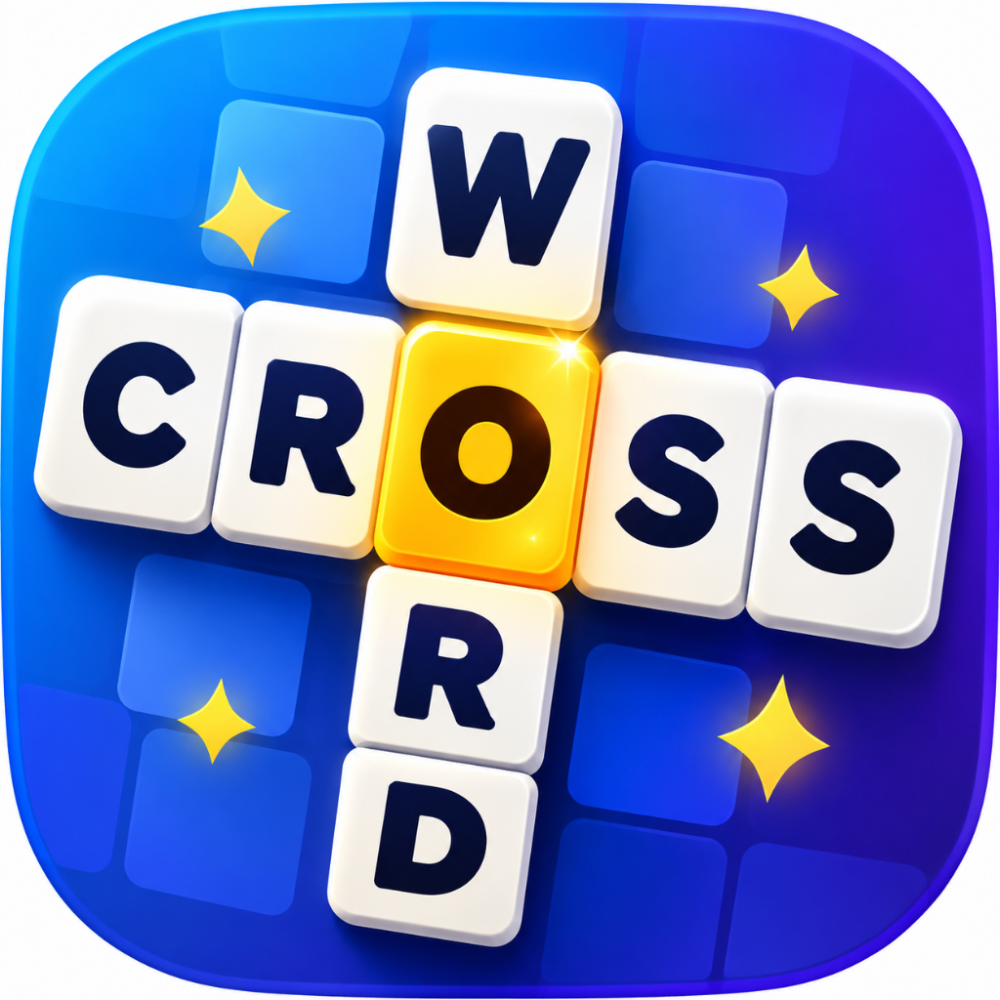
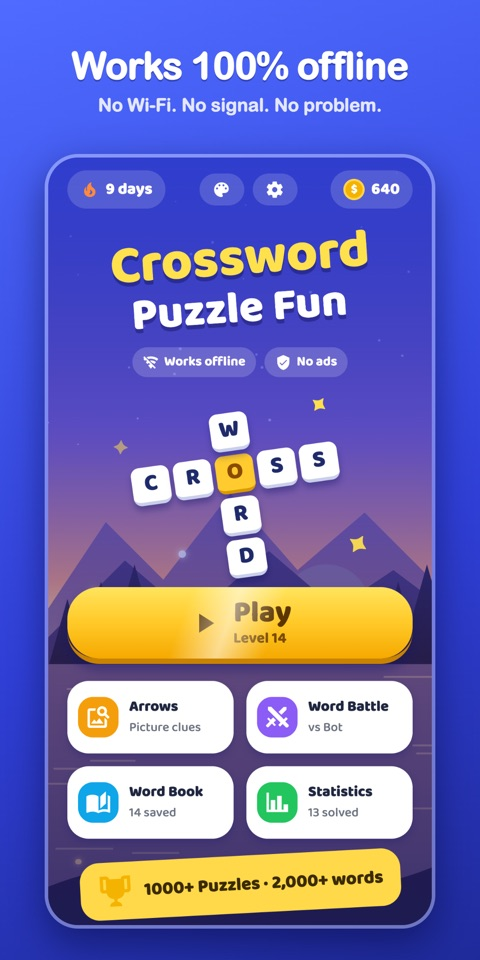
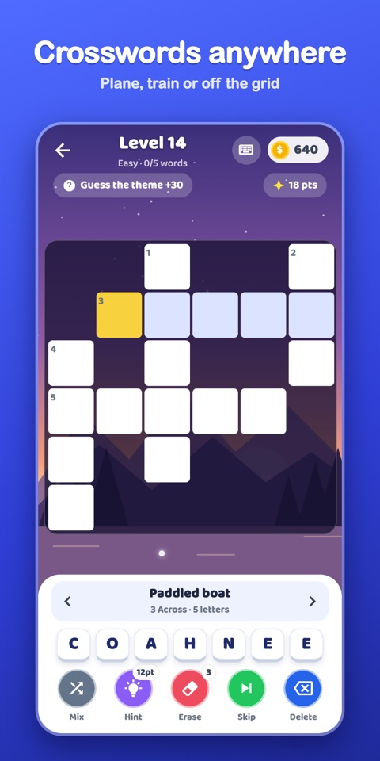
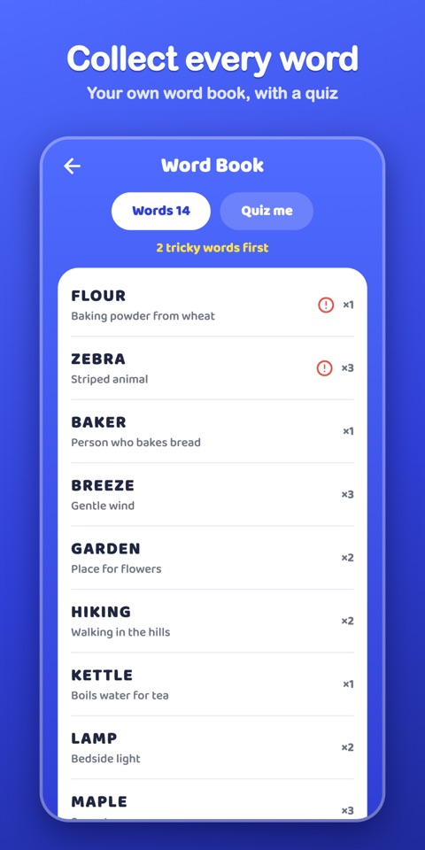
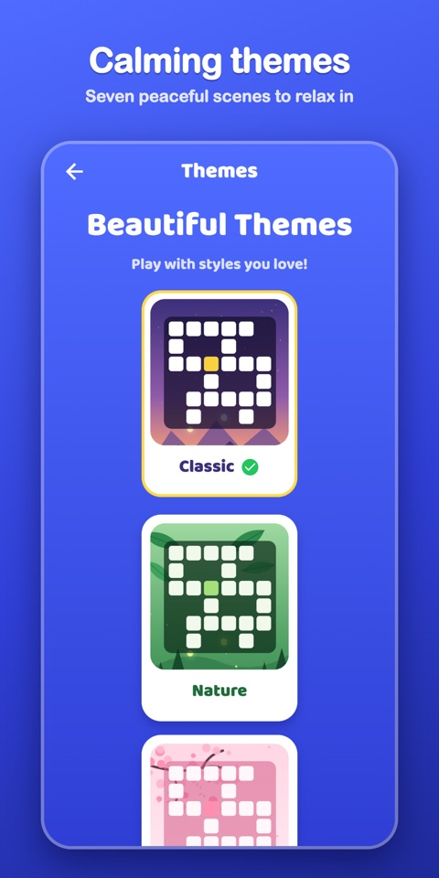
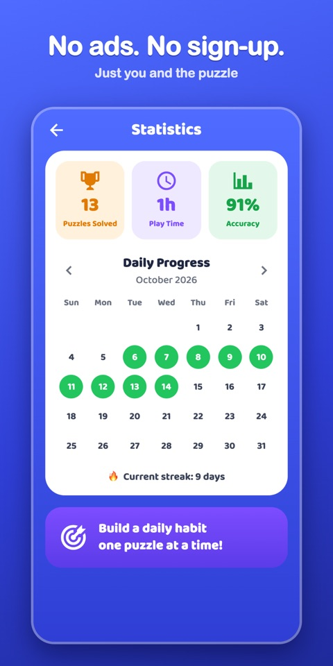

<div align="center">



# WordCross — Offline Crossword

**Calm, ad-free crossword puzzles for iOS and Android that work with no internet.**

1000+ levels from easy to hard, beautiful animated themes, letter tiles or a full keyboard —
and nothing leaves your device.

[](https://github.com/aby050/wordcross/actions/workflows/ci.yml)
[](LICENSE)


[](CONTRIBUTING.md)

[](https://play.google.com/store/apps/details?id=com.abhay.wordcross)
[](https://apps.apple.com/app/id6817191231)

</div>

## Screenshots

<p align="center">
  
  
  
  
  
</p>

## Features

- **1000+ levels** generated from 2,000+ everyday words and hand-written clues.
- **Animated themes** — Lake at dusk, Nature, Blossom, Ocean, Night, Autumn and Wood.
- **Letter tiles or keyboard** — tiles include a few decoys; the keyboard is the classic challenge.
- **Power-ups** — reveal a letter, erase mistakes, jump to another clue.
- **Streaks and stats** — daily coins, a progress calendar, accuracy and play time.
- **Bonus modes** — picture-clue arrow puzzles and a word battle against a friendly bot.
- **100% offline and private** — no ads, no sign-up, no analytics; progress lives in AsyncStorage.

## Getting started

Requires Node 20+ and the Expo toolchain.

```bash
git clone https://github.com/aby050/wordcross.git
cd wordcross
npm install
npx expo start          # press w for web, a for Android, i for iOS
```

Typecheck before opening a pull request:

```bash
npx tsc --noEmit
```

## Project structure

| Path | What lives there |
|---|---|
| `App.tsx` | Entry point and navigation between screens |
| `src/cross/` | Crossword mode: screens, level generator (`generate.ts`), clues, themes, store |
| `src/cross/bank/` | Word and clue bank |
| `src/ArrowGame.tsx`, `src/arrowPuzzles.ts` | Picture-clue arrow puzzles |
| `src/WordGame.tsx`, `src/scrabble.ts` | Word battle mode |
| `src/progress.ts` | Saved progress, coins and streaks |
| `assets/` | Icons, splash and sounds |
| `store/` | Store listing copy, screenshots and privacy page |
| `scripts/` | Release scripts (maintainer only) |

## Contributing

Bug reports, new clues, themes and puzzle modes are welcome. Read [CONTRIBUTING.md](CONTRIBUTING.md)
and the [Code of Conduct](CODE_OF_CONDUCT.md) first. Good first contributions:

- fix or improve a clue in `src/cross/bank/`,
- add a theme in `src/cross/themes.ts`,
- report a level whose words overlap badly (include the level number).

## Privacy

WordCross collects no data. See the [privacy policy](https://rvastudio.in/wordcross/privacy).

## License

[MIT](LICENSE). Use, modify and ship it freely, including commercially.

The WordCross name, icon and store listings belong to RVA Studio and are not covered by the code license.
